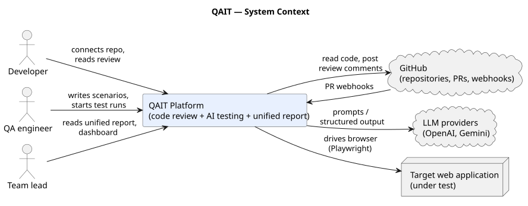
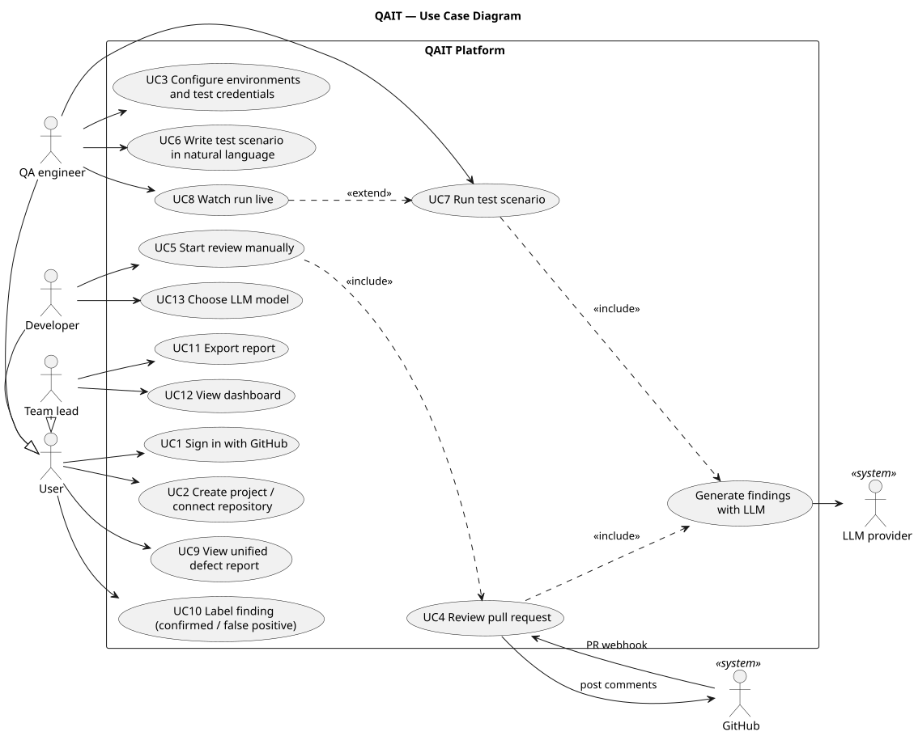
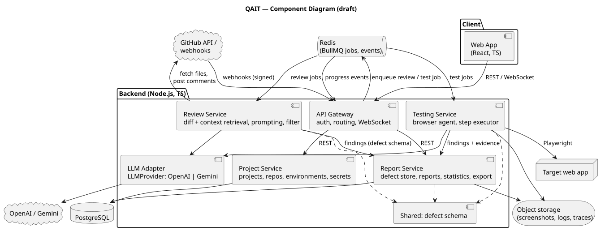
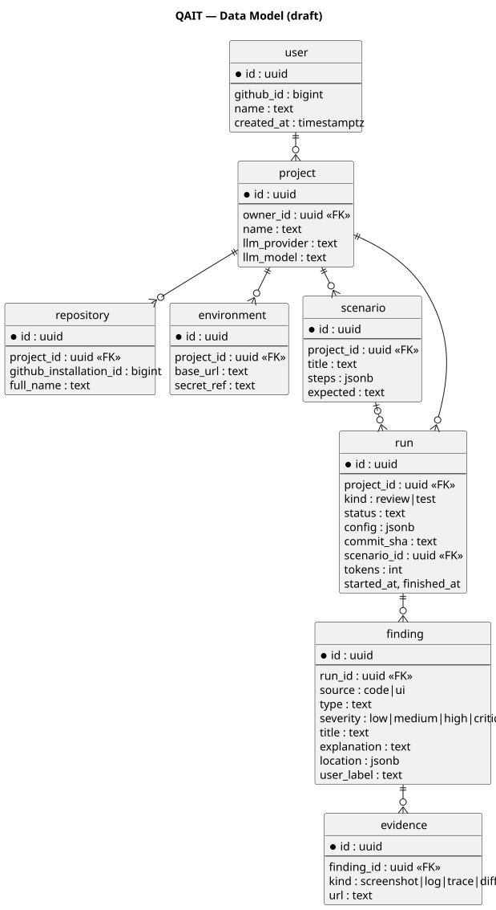
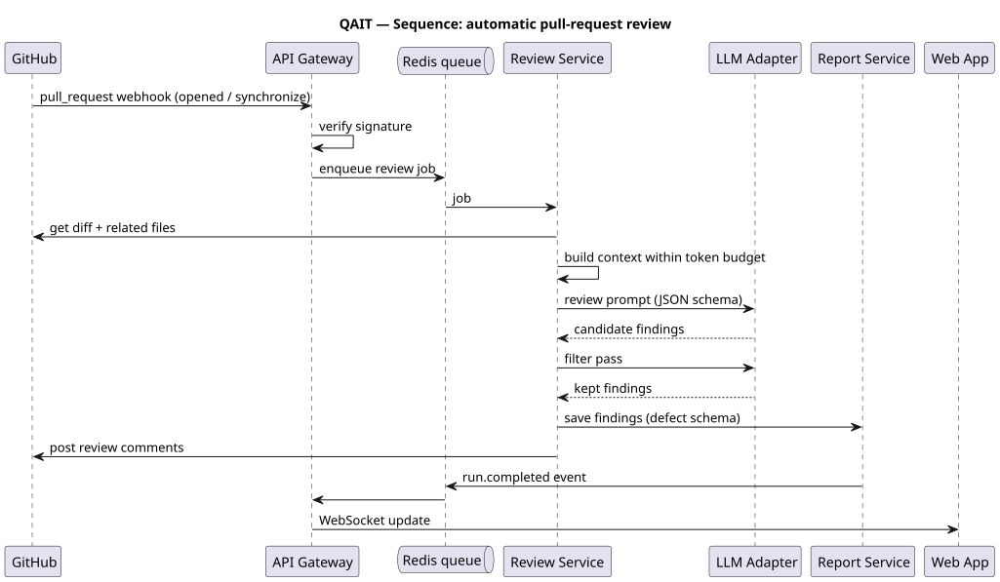
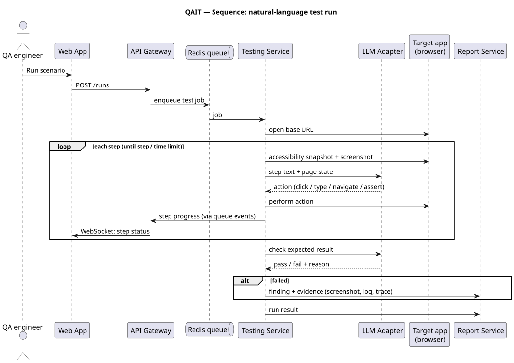

# 7. Architecture

Editable sources are in [`diagrams/src`](../diagrams/src) (PlantUML) and the exports in [`diagrams/export`](../diagrams/export). To re-render:

```bash
java -jar plantuml.jar -tsvg -o ../export diagrams/src/*.puml
```

## 7.1 System context



QAIT has three human user roles and three external systems:
- **GitHub** is the source of code and pull-request events, and receives review comments.
- **LLM providers** do the reasoning for review and testing.
- **Target web application** is the system under test, driven through a real browser.

## 7.2 Use cases



| Use case | Requirements |
|---|---|
| UC1 Sign in | FR-P1 |
| UC2 Create project / connect repository | FR-P2 |
| UC3 Environments and credentials | FR-P3, FR-P4 |
| UC4 Review pull request | FR-CR1, CR3–CR6 |
| UC5 Start review manually | FR-CR2 |
| UC6 Write scenario | FR-T1 |
| UC7 Run scenario | FR-T2, T3, T5 |
| UC8 Watch run live | FR-T4 |
| UC9 Unified report | FR-R2, FR-D1, D2 |
| UC10 Label finding | FR-R3 |
| UC11 Export | FR-R4 |
| UC12 Dashboard | FR-R5 |
| UC13 Choose model | FR-CR7 |

## 7.3 Components (draft)



| Component | Responsibility | Main requirements | Owner |
|---|---|---|---|
| Web App | UI for projects, scenarios, runs, report, dashboard | FR-P*, FR-R*, FR-T4 | Нариман |
| API Gateway | Authentication (GitHub OAuth, JWT), routing, webhook verification, WebSocket fan-out | FR-P1, NFR-S2, NFR-S3 | Бекнұр |
| Project Service | Projects, repositories, environments, encrypted secrets | FR-P2–P4, NFR-S1 | Бекнұр |
| Review Service | Fetch diff and related files, build context, prompt, filter, post comments | FR-CR* | Бекнұр |
| Testing Service | Browser agent: page snapshot, action choice, execution, evidence capture | FR-T* | Бекнұр, Максот |
| Report Service | Store findings, unified report, labels, statistics, export | FR-D*, FR-R* | Бекнұр, Нариман |
| LLM Adapter | `LLMProvider` interface; OpenAI and Gemini adapters; token and cost accounting | FR-CR7, NFR-M2, NFR-C1 | Бекнұр |
| Evaluation tools | Batch runs over the bench, CSV export, metrics | FR-EV* | Максот |

**Interaction.** The client talks to the gateway over REST and WebSocket. Long-running work (reviews, test runs) is put on a Redis/BullMQ queue, so the gateway never waits on an LLM call. This allows retries (NFR-R1) and lets the review and testing workers be scaled separately. Workers publish progress events, and the gateway forwards them to the client.

## 7.4 Data model (draft)



A **run** is one execution of either a review (`kind = review`, tied to a commit) or a test (`kind = test`, tied to a scenario). Both kinds produce **findings** in the same schema. The schema is in [`src/shared/defect.schema.json`](../src/shared/defect.schema.json). The unified report (FR-R2) is a query over findings for a commit range or release, joined across both run kinds.

## 7.5 Key scenarios

**Automatic PR review**



**Natural-language test run**



## 7.6 Architectural decisions

| ID | Decision | Alternatives | Reason |
|---|---|---|---|
| AD-1 | Separate review and testing workers behind a queue | One monolith | Very different run time and resources (browser vs. API calls); independent scaling and failure |
| AD-2 | One defect schema shared by all services | Per-service formats | Required for the unified report and for the evaluation (same matching against ground truth) |
| AD-3 | LLM behind an adapter interface | Direct SDK calls | Model comparison in experiments; vendor independence |
| AD-4 | Page state for the agent = accessibility snapshot + screenshot, not full HTML | Full DOM; screenshot only | Fewer tokens and better element choice [L10]; screenshot kept as evidence |
| AD-5 | Two-pass review (generate, then filter) | Single pass | Higher precision reported in industry [L7] |
| AD-6 | Evidence files in object storage, metadata in PostgreSQL | Blobs in DB | Database size and backup cost |
