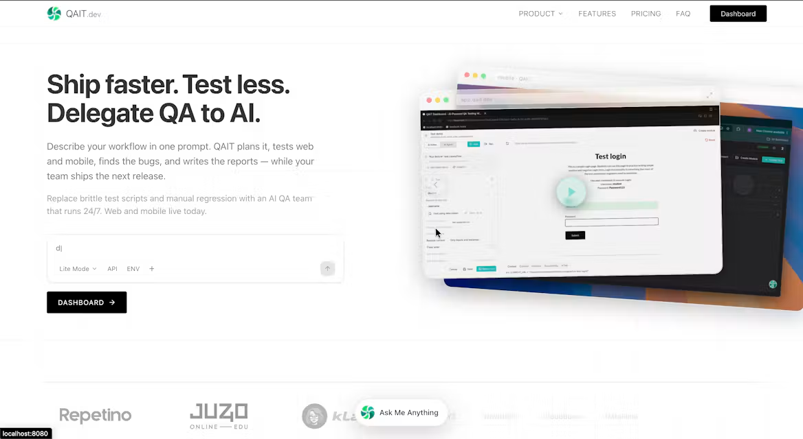

# 8. UX Prototype

Owner: Қайдар Н.Н.

Screens: [`docs/prototype/`](prototype/)

## Starting point: QAIT.dev



QAIT.dev is the team's prior product: a prompt-driven AI testing tool for web and mobile. Its visual style and its test editor are the starting point for the testing screens (S3). The code-review screens (S2), the unified report (S4) and the dashboard (S5) are new for this project; their screen flow is planned below and will be prototyped before pre-defense 2.

## Key scenarios (planned screen flow)

| # | Scenario | Screens | Use cases |
|---|---|---|---|
| S1 | First start: sign in, create project, connect GitHub repo | Sign-in → Projects → New project → GitHub App install → Project overview | UC1, UC2 |
| S2 | Review a pull request | Project → Pull requests → Review run (progress) → Findings list → Finding detail (code + explanation + suggested fix) | UC4, UC5 |
| S3 | Write and run a test | Scenarios → Editor (steps, expected result, environment) → Live run (step list + screenshot) → Result | UC6, UC7, UC8 |
| S4 | Unified report | Reports → Release / commit range → Findings from code and UI, filters by source, severity, type → Label finding | UC9, UC10 |
| S5 | Dashboard | Findings by type / severity, precision from labels, trend | UC12 |

## Example API (for external systems)

```http
POST /api/projects/{projectId}/runs
Content-Type: application/json

{ "kind": "test", "scenarioId": "b6e1…", "environmentId": "9c0a…" }
```

```json
{ "runId": "4f2d…", "status": "queued" }
```

`GET /api/runs/{runId}/findings` returns an array of findings in the [defect schema](../src/shared/defect.schema.json).
